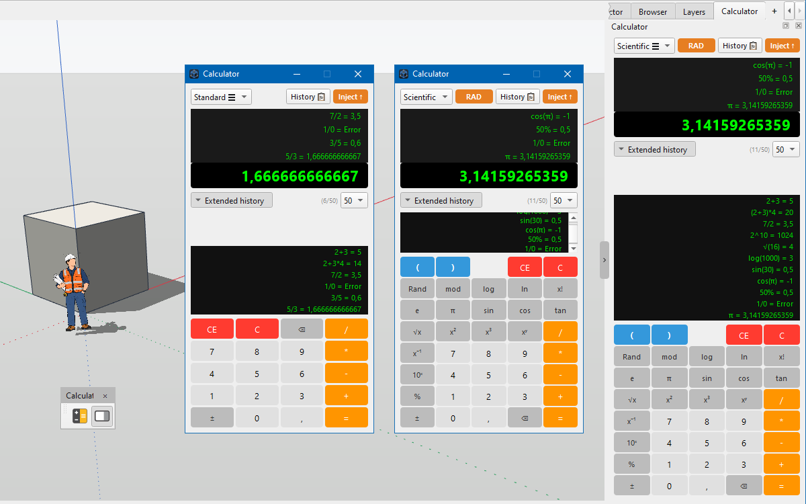

# IngeTrazo Extension — "Calculator"

A **toolbar** and a **side panel** for [IngeTrazo](https://github.com/ingelibre/ingetrazo)
that turn the calc into a real workspace tool: **standard / scientific
calculator**, **scrollable extended history** (4–50 entries), **physical
keyboard input**, **one‑click injection into the VCB** (Value Control Box),
**live synchronization** between dialog and panel, and full
**internationalization** (pt‑BR / en / es, with room for more).

Repository: <https://github.com/em-rezende/Ingetrazo-igz-calculator>

- **Author:** Ezequiel M. Rezende
- **Date:** 2026‑11‑07
- **Version:** 1.1.0
- **License:** [GPL-3.0-or-later](https://www.gnu.org/licenses/gpl-3.0.html)
  (same as IngeTrazo — see [LICENSE](https://github.com/ingelibre/ingetrazo/blob/main/LICENSE))

---



*The **Calculator** toolbar, the side panel, and the extended history.*

---

## Files

```
<plugins>/
└── igz_calculator/
    ├── igz_calculator.py     # the entire extension (single file)
    ├── README.md             # this file (English)
    ├── README_ptBR.md        # Portuguese version
    ├── LICENSE               # full GPL-3.0 text
    ├── i18n/
    │   ├── en.json
    │   ├── pt-BR.json
    │   └── es.json
    └── icons/
        ├── calculator.svg         / calculator_light.svg
        └── calculator_panel.svg   / calculator_panel_light.svg
```

`igz_calculator.py` is a **single‑file, self‑contained plugin**: it defines
`setup(app)`, so it works when dropped straight into the plugins folder
(or wrapped in a one‑folder `.zip`, see [Installation](#installation)).

It has **no runtime dependencies beyond PySide6** — in particular it does
**not** use `QtWebEngine` or `QtWebChannel`, so it works in a
`PySide6‑Essentials` host such as the packaged IngeTrazo.

---

## The "Calculator" toolbar

Two buttons, both in the **top area** (`igz_tb_calculator`):

| Button                | Icon               | What it does |
|-----------------------|--------------------|--------------|
| **Calculator**        | `calculator`       | Opens the floating **dialog**. |
| **Calculator Panel**  | `calculator_panel` | Shows/hides the **side panel** (dock or tab), or focuses it if it was inserted as a tab. |

Icons follow the host's light/dark palette (each icon has a `_light`
variant). If a file is missing the extension falls back to
`calculator.svg`, then to `QStyle.SP_ComputerIcon`, so the toolbar is
always visible.

The dialog is **always brought to the front** when opened; a second click
just raises the existing window.

---

## The calculator UI

The same native Qt widget is used for **both** the floating dialog and the
side panel — only the container changes. It remembers its own state
between sessions.

- **Display** — one large current‑value line, **4 fixed history lines**,
  and an **extended history block** with its own **vertical scrollbar**.
  The extended block grows to use available space (a lot on the panel, less
  on the dialog) and shows **4, 10, 25 or 50** entries (user choice).
- **Mode selector** — **Standard** (4×5 keypad) or **Scientific**
  (8×5 keypad with `( )`, `Rand`, `mod`, `log`, `ln`, `x!`, `e`, `π`,
  `sin`, `cos`, `tan`, `√x`, `x²`, `x³`, `xʸ`, `x⁻¹`, `10ˣ`, `%`, `±`, `⌫`).
- **Angle toggle** — **DEG** / **RAD**, shown only in Scientific mode.
  Blue (`#2c3e50`) in DEG, orange (`#e67e22`) in RAD.
- **Histórico 📋** — copies **all** visible history lines plus the
  current value to the clipboard.
- **Injetar ↑** — **injects** the current value into the **VCB** (Value
  Control Box), the currently focused numeric field in IngeTrazo. If no
  VCB is available it **falls back to the clipboard** and shows
  "Copiado! ✔" instead of "Injetado! ✔".

---

## Expressions and operators

The parser accepts a single expression at a time, with the following
operators and functions:

- **Arithmetic:** `+ - * / ( )`, implicit multiplication (`2π`, `60rand`).
- **Powers and roots:** `x²` (`sqr`), `x³` (`cube`), `xʸ` (`pow`), `x⁻¹`
  (`inv`), `10ˣ` (`pow10`), `√` (`sqrt`).
- **Logarithms:** `log` (base 10) and `ln` (natural).
- **Trigonometry:** `sin`, `cos`, `tan`, using the current DEG/RAD factor.
- **Misc.:** `mod` (remainder), `x!` (factorial), `%` (percent = `/100`),
  `Rand` (uniform random), `±` (negate the whole expression), `⌫`
  (backspace).
- **Constants:** `π` and `e`.

Results are rounded to **12 decimal places** and displayed with a comma as
the decimal separator (pt‑BR style). Errors are shown as **Erro** (or
**Error** in English mode) and any of `C`, `CE`, or the next digit clears
them.

> Note on the unary `±`: it wraps the **entire** current expression in
> `-(…)`. To negate the argument of a function, type the minus inside the
> parentheses (e.g. `ln ( 1 ± )`), otherwise the negation applies to the
> whole function result.

> Note on `%`: it is a plain division by 100 (`50 + 10% = 50,1`), not the
> "commercial" `% of the left operand` (`50 + 10% = 55`). Both behaviours
> are reasonable; the extension uses the simpler one.

---

## Physical keyboard

When the calculator (dialog **or** panel) has focus, these keys work:

| Key | Action |
|---|---|
| `0` – `9` | Digits |
| `+ - * /` | Operators |
| `( )` | Parentheses |
| `,` or `.` | Decimal separator |
| `=` or `Enter` | Calculate |
| `Backspace` | Delete last character |
| `Esc` | Clear all (`C`) |
| `Del` | Clear current (`CE`) |
| `r` | Toggle DEG / RAD |
| `p` / `e` | π / Euler's constant |
| `s` / `q` / `c` / `^` | √, x², x³, xʸ |
| `%` / `!` | Percent / factorial |
| `n` / `l` / `i` / `m` | ln, log, x⁻¹, mod |

The keys **do not** interfere with the VCB: when focus is outside the
calculator, all keys go to the host, as expected.

---

## History and synchronization

- **4 fixed lines** at the top of the display — always the 4 most recent
  entries, regardless of the configured limit.
- **Extended history** below, with a **vertical scrollbar**, showing the
  last **4 / 10 / 25 / 50** entries (configurable from the combo next to
  the "Histórico extenso" header). The block grows to use available space,
  so on the **side panel** you typically see dozens of lines at once.
- **Dialog and panel share the same state**: a calculation, mode change,
  angle toggle or clear action on one is reflected on the other in real
  time.
- **Persistence** — `history`, `history_limit`, `is_rad` and `mode` are
  saved in `state.json` under the application data folder
  (`.../igz_calculator/state.json`), so they survive closing and reopening
  and even restarting IngeTrazo.

---

## Internationalization

All visible strings go through `_t(...)`, which resolves in this order:

1. **`core.i18n.tr()`** of the host — if the host has a translation
   registered, it wins.
2. **`i18n/<lang>.json`** of the plugin — a per‑extension translation file.
3. **`_TEXTS`** hardcoded dictionary in `igz_calculator.py` — a built‑in
   fallback for `en` and `es`.
4. **Identity** — returns the source string unchanged (pt‑BR default).

Ships with **pt‑BR**, **en** and **es**. Adding a new language is a matter
of dropping `i18n/it.json` (or any other) with the same keys — no code
change needed.

---

## Fragile points (depend on the host)

- **Main‑window discovery** — `setup(app)` locates the host window by
  `app.main_window` / `app.window`, then by `QApplication.topLevelWidgets()`
  (visible `QMainWindow` first, then any widget with `addToolBar`), then by
  `app` itself if it has `addToolBar`. The discovery is retried for a few
  seconds, so a host that shows its window later still gets the toolbar.
- **Toolbar restoration** — a deferred re‑check at 1.5 s recreates the
  toolbar if the host called `QMainWindow.restoreState()` after the plugin
  ran. This is the same pattern used by `igz_tb_scenes`.
- **Panel host discovery** — the calculator panel tries to be a **tab**
  next to Property / BIM / Terrain / Render / IA panels; if it cannot
  find a suitable `QTabWidget`, it becomes a **dock** in the same area;
  if the host has no `addDockWidget`, the panel is skipped (the dialog
  still works).
- **VCB injection** — the "Injetar ↑" button uses the **last focused
  editable widget** (`QLineEdit` / `QSpinBox` / `QDoubleSpinBox`) as the
  target. The tracker is installed the first time `run()` is called and
  only records widgets focused **while the calculator is closed**. If no
  VCB is available, the button copies the value to the clipboard instead.
- **Qt style icon** — when no `icons/calculator*.svg` is present, the
  extension falls back to `QStyle.SP_ComputerIcon`. If you want a custom
  look, drop a 24×24 SVG named `calculator.svg` (and
  `calculator_light.svg`) into `icons/`.

### If the 0.x API breaks

The only integration points are `setup(app)`, `QMainWindow.addToolBar`
and `QMainWindow.addDockWidget`. If a future IngeTrazo changes them, only
the small helpers at the bottom of `igz_calculator.py`
(`_find_main_window`, `_add_toolbar`, `_attach_calculator_panel`,
`_try_setup`, `_ensure_toolbar`) need adjustment. The calculator itself is
fully self‑contained.

---

## Installation

### Manual (scripts / development)

1. In IngeTrazo, use **Extensions ▸ Open plugins folder** (or open the
   user plugins folder: `%APPDATA%\IngeTrazo\plugins\` on Windows,
   `~/.local/share/ingetrazo/plugins/` on Linux).
2. Create a folder named **`igz_calculator`** inside it.
3. Copy into it:
   - `igz_calculator.py`
   - `i18n/` (with `en.json`, `pt-BR.json`, `es.json`)
   - `icons/` (optional)
   - an `__init__.py` that re‑exports `setup` (see note below)
4. Restart IngeTrazo. The **Calculator** and **Calculator Panel** buttons
   appear in the top toolbar area.

> If your host requires a package, the folder **must** contain an
> `__init__.py` that re‑exports `setup`:
>
> ```python
> from .igz_calculator import (
>     setup, register, init, load, on_load, run, create_toolbar,
> )
> ```
>
> Without a valid entry point, the host silently shows **no** toolbar and
> **no** panel.

### From the IngeTrazo extension catalog

Packaged for the community catalog at
<https://ingetrazo.com/extensiones> (repository
<https://github.com/ingelibre/ingetrazo-extensions>), which installs a
single `.zip` containing a folder with an `__init__.py`. See
[`PUBLISHING.md`](PUBLISHING.md) if you package it yourself.

The source of truth for this extension is
<https://github.com/em-rezende/Ingetrazo-igz-calculator>.

---

## Usage

1. Click the **Calculator** button in the top toolbar (floating dialog)
   or the **Calculator Panel** button (side panel).
2. Choose **Padrão** (Standard) or **Científica** (Scientific) from the
   mode selector, and **DEG** / **RAD** for trigonometry.
3. Type the expression. Use the on‑screen keypad, the **physical
   keyboard**, or a mix of both. Every `=` pushes the result to the four
   fixed lines and to the extended history (with vertical scrollbar).
4. Click **Injetar ↑** to send the current value to the **VCB** (the
   focused numeric field in IngeTrazo), or **Histórico 📋** to copy all
   history lines to the clipboard.

---

## Future improvements (optional)

None of these is required — the extension works as it is.

1. **Context‑aware `±`** — negate only the innermost argument of the
   current function, instead of the whole expression.
2. **Commercial `%`** — make `a + b%` mean `a + a·b/100`.
3. **Synchronize `history_limit`** between dialog and panel — currently
   each one keeps its own limit; a real‑time sync is a small addition.
4. **`Tool` subclass** — a "Calculator…" entry in the **Extensions** menu
   with a shortcut, to reopen the toolbar if it is closed.
5. **Sci‑mode label** — show a small `RAD` / `DEG` badge in the current
   display line, in addition to the toggle button.
6. **More languages** — additional `i18n/*.json` files.

---

## License

GPL-3.0-or-later — the same license as IngeTrazo.

See <https://www.gnu.org/licenses/gpl-3.0.html>.

Copyright (C) 2026 Ezequiel M. Rezende.

This program is free software: you can redistribute it and/or modify
it under the terms of the GNU General Public License, version 3 or later,
as published by the Free Software Foundation.

This program is distributed in the hope that it will be useful, but
**without any warranty**; without even the implied warranty of
**merchantability** or **fitness for a particular purpose**. See the
GNU General Public License for more details.

---

### Correspondence table (EN ↔ PT-BR)

| Section | English | Português |
|---|---|---|
| Title | Extension — "Calculator" | Extensão — "Calculadora" |
| Files | Files | Arquivos |
| Toolbar | The "Calculator" Toolbar | A barra "Calculator" |
| UI | The calculator UI | A interface da calculadora |
| Expressions | Expressions and operators | Expressões e operadores |
| Keyboard | Physical keyboard | Teclado físico |
| History | History and synchronization | Histórico e sincronização |
| i18n | Internationalization | Internacionalização |
| Fragile points | Fragile points | Pontos frágeis |
| Installation | Installation | Instalação |
| Usage | Usage | Uso |
| Future improvements | Future improvements | Melhorias futuras |
| License | License | Licença |
```
