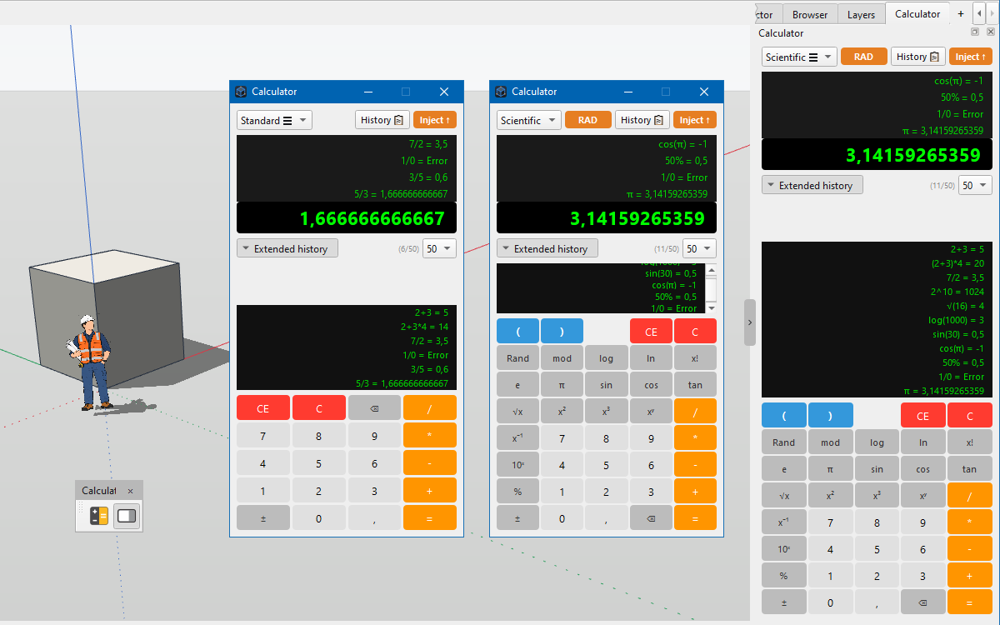

# Extensão IngeTrazo — "Calculadora"

Uma **barra de ferramentas** e um **painel lateral** para o
[IngeTrazo](https://github.com/ingelibre/ingetrazo) que transformam a
calculadora em uma ferramenta de trabalho de verdade: **calculadora
padrão / científica**, **histórico extenso rolável** (4–50 entradas),
**entrada por teclado físico**, **injeção em um clique no VCB**
(*Value Control Box*), **sincronização em tempo real** entre o diálogo e
o painel, e **internacionalização completa** (pt‑BR / en / es / it / fr / de / zh,
com espaço para mais idiomas).

Repositório: <https://github.com/em-rezende/Ingetrazo-igz-calculator>

- **Autor:** Ezequiel M. Rezende
- **Data:** 2026‑11‑07
- **Versão:** 1.2.0
- **Licença:** [GPL-3.0-or-later](https://www.gnu.org/licenses/gpl-3.0.html)
  (mesma do IngeTrazo — ver [LICENSE](https://github.com/ingelibre/ingetrazo/blob/main/LICENSE))

---



*A barra **Calculadora**, o painel lateral e o histórico extenso.*

---

## Arquivos

```
<plugins>/
└── igz_calculator/
    ├── igz_calculator.py     # a extensão inteira (arquivo único)
    ├── README.md             # este arquivo (inglês)
    ├── README_ptBR.md        # esta versão em português
    ├── LICENSE               # texto completo da GPL-3.0
    ├── i18n/
    │   ├── en.json
    │   ├── pt-BR.json
    │   ├── es.json
    │   ├── it.json
    │   ├── fr.json
    │   ├── de.json
    │   └── zh.json
    └── icons/
        ├── calculator.svg         / calculator_light.svg
        └── calculator_panel.svg   / calculator_panel_light.svg
```

`igz_calculator.py` é um **plugin autônomo de arquivo único**: define
`setup(app)`, então funciona quando colocado diretamente na pasta de
plugins (ou embalado em um `.zip` de uma pasta só, ver
[Instalação](#instalação)).

Ele **não tem dependências em tempo de execução além do PySide6** — em
particular **não** usa `QtWebEngine` nem `QtWebChannel`, então funciona
em um host `PySide6-Essentials`, como o IngeTrazo empacotado.

---

## A barra "Calculadora"

Dois botões, ambos na **área superior** (`igz_tb_calculator`):

| Botão                    | Ícone              | O que faz |
|--------------------------|--------------------|-----------|
| **Calculadora**          | `calculator`       | Abre o **diálogo** flutuante. |
| **Painel Calculadora**   | `calculator_panel` | Mostra/esconde o **painel lateral** (dock ou aba), ou foca a aba se ela tiver sido inserida como aba. |

Os ícones seguem a paleta clara/escura do host (cada ícone tem uma
variante `_light`). Se um arquivo faltar, a extensão cai para
`calculator.svg`, depois para `QStyle.SP_ComputerIcon` — assim a barra
está sempre visível.

O diálogo é **sempre trazido para frente** ao abrir; um segundo clique
apenas levanta a janela existente.

---

## A interface da calculadora

O mesmo widget nativo do Qt é usado **tanto** no diálogo flutuante
**quanto** no painel lateral — só o contêiner muda. Ele guarda o próprio
estado entre sessões.

- **Display** — uma linha grande para o valor atual, **4 linhas fixas de
  histórico** e um **bloco de histórico extenso** com **barra de rolagem
  vertical** própria. O bloco cresce para usar o espaço disponível
  (muito no painel, menos no diálogo) e mostra **4, 10, 25 ou 50**
  entradas (escolha do usuário).
- **Seletor de modo** — **Padrão** (teclado 4×5) ou **Científica**
  (teclado 8×5 com `( )`, `Rand`, `mod`, `log`, `ln`, `x!`, `e`, `π`,
  `sin`, `cos`, `tan`, `√x`, `x²`, `x³`, `xʸ`, `x⁻¹`, `10ˣ`, `%`, `±`, `⌫`).
- **Alternador de ângulo** — **DEG** / **RAD**, exibido apenas no modo
  Científica. Azul (`#2c3e50`) em DEG, laranja (`#e67e22`) em RAD.
- **Histórico 📋** — copia **todas** as linhas visíveis do histórico
  mais o valor atual para o clipboard.
- **Injetar ↑** — **injeta** o valor atual no **VCB** (*Value Control
  Box*), o campo numérico em foco no IngeTrazo. Se não houver VCB
  disponível, **cai para o clipboard** e mostra **"Copiado! ✔"** em vez
  de **"Injetado! ✔"**.

---

## Expressões e operadores

O parser aceita uma expressão por vez, com os seguintes operadores e
funções:

- **Aritmética:** `+ - * / ( )`, multiplicação implícita (`2π`, `60rand`).
- **Potências e raízes:** `x²` (`sqr`), `x³` (`cube`), `xʸ` (`pow`),
  `x⁻¹` (`inv`), `10ˣ` (`pow10`), `√` (`sqrt`).
- **Logaritmos:** `log` (base 10) e `ln` (natural).
- **Trigonometria:** `sin`, `cos`, `tan`, usando o fator DEG/RAD atual.
- **Diversos:** `mod` (resto), `x!` (fatorial), `%` (porcentagem = `/100`),
  `Rand` (aleatório uniforme), `±` (nega a expressão inteira), `⌫`
  (backspace).
- **Constantes:** `π` e `e`.

Os resultados são arredondados para **12 casas decimais** e exibidos com
vírgula como separador decimal (estilo pt-BR). Erros aparecem como
**Erro** (ou **Error** em inglês) e qualquer `C`, `CE` ou o próximo
dígito os limpa.

> Nota sobre o `±` unário: ele envolve a **expressão inteira** atual em
> `-(…)`. Para negar o argumento de uma função, digite o sinal de menos
> dentro dos parênteses (ex.: `ln ( 1 ± )`); caso contrário, a negação
> aplica-se ao resultado da função inteira.

> Nota sobre `%`: é uma divisão simples por 100 (`50 + 10% = 50,1`), não o
> "comercial" `% do operando da esquerda` (`50 + 10% = 55`). Ambos os
> comportamentos são razoáveis; a extensão usa o mais simples.

---

## Teclado físico

Quando a calculadora (diálogo **ou** painel) está com foco, estas teclas
funcionam:

| Tecla | Ação |
|---|---|
| `0` – `9` | Dígitos |
| `+ - * /` | Operadores |
| `( )` | Parênteses |
| `,` ou `.` | Separador decimal |
| `=` ou `Enter` | Calcular |
| `Backspace` | Apaga o último caractere |
| `Esc` | Limpa tudo (`C`) |
| `Del` | Limpa a entrada atual (`CE`) |
| `r` | Alterna DEG / RAD |
| `p` / `e` | π / constante de Euler |
| `s` / `q` / `c` / `^` | √, x², x³, xʸ |
| `%` / `!` | Porcentagem / fatorial |
| `n` / `l` / `i` / `m` | ln, log, x⁻¹, mod |

As teclas **não** interferem no VCB: quando o foco está fora da
calculadora, todas as teclas vão para o host, como esperado.

---

## Histórico e sincronização

- **4 linhas fixas** no topo do display — sempre as 4 mais recentes,
  independentemente do limite configurado.
- **Histórico extenso** abaixo, com **barra de rolagem vertical**,
  mostrando as últimas **4 / 10 / 25 / 50** entradas (configurável no
  combo ao lado do cabeçalho "Histórico extenso"). O bloco cresce para
  usar o espaço disponível, então no **painel lateral** você
  normalmente vê dezenas de linhas de uma vez.
- **Diálogo e painel compartilham o mesmo estado**: um cálculo, mudança
  de modo, alternância de ângulo ou limpeza em um é refletido no outro
  em tempo real.
- **Persistência** — `history`, `history_limit`, `is_rad` e `mode` são
  salvos em `state.json`, na pasta de dados do aplicativo
  (`.../igz_calculator/state.json`), então sobrevivem a fechar e reabrir
  e até a reiniciar o IngeTrazo.

---

## Internacionalização

Todas as strings visíveis passam por `_t(...)`, que resolve nesta ordem:

1. **`core.i18n.tr()`** do host — se o host tiver uma tradução
   registrada, ela vence.
2. **`i18n/<lang>.json`** do plugin — arquivo de tradução por extensão,
   indexado pela string-fonte em pt-BR.
3. **`_TEXTS`** hardcoded em `igz_calculator.py` — traduções embutidas
   para `en`, `es`, `it`, `fr`, `de` e `zh`.
4. **Identidade** — devolve a string-fonte sem alteração (padrão pt-BR).

Vem com **pt-BR**, **en**, **es**, **it**, **fr**, **de** e **zh**
(chinês simplificado). O idioma vem do host (`_lang_key()`), com fallback
por idioma-base (ex.: `zh-CN` / `zh-Hans` → `zh`). As traduções embutidas
efetivas ficam em `_TEXTS`; os arquivos `i18n/<lang>.json` espelham as
mesmas strings para referência.

---

## Pontos frágeis (dependem do hospedeiro)

- **Descoberta da janela principal** — `setup(app)` localiza a janela do
  hospedeiro por `app.main_window` / `app.window`, depois por
  `QApplication.topLevelWidgets()` (`QMainWindow` visível primeiro,
  depois qualquer widget com `addToolBar`), depois pelo próprio `app`,
  se ele tiver `addToolBar`. A descoberta é repetida por alguns segundos,
  então um hospedeiro que mostra a janela mais tarde ainda recebe a barra.
- **Restauração da barra** — uma re-verificação tardia em 1,5 s recria a
  barra se o hospedeiro chamou `QMainWindow.restoreState()` depois que o
  plugin rodou. É o mesmo padrão usado pelo `igz_tb_scenes`.
- **Descoberta do painel** — o painel da calculadora tenta virar **aba**
  ao lado dos painéis Propriedades / BIM / Terreno / Renderizar / IA; se
  não achar um `QTabWidget` adequado, vira um **dock** na mesma área; se
  o host não tiver `addDockWidget`, o painel é pulado (o diálogo continua
  funcionando).
- **Injeção no VCB** — o botão **Injetar ↑** usa o **último widget
  editável focado** (`QLineEdit` / `QSpinBox` / `QDoubleSpinBox`) como
  alvo. O rastreador é instalado na primeira chamada a `run()` e só
  registra widgets focados **com a calculadora fechada**. Se não houver
  VCB disponível, o botão copia o valor para o clipboard.
- **Ícone do tema Qt** — quando não há `icons/calculator*.svg`, a
  extensão cai para `QStyle.SP_ComputerIcon`. Se quiser um visual
  próprio, coloque um SVG 24×24 chamado `calculator.svg` (e
  `calculator_light.svg`) em `icons/`.

### Se a API 0.x quebrar

Os únicos pontos de integração são `setup(app)`,
`QMainWindow.addToolBar` e `QMainWindow.addDockWidget`. Se um IngeTrazo
futuro mudar isso, só os pequenos auxiliares no final de
`igz_calculator.py` (`_find_main_window`, `_add_toolbar`,
`_attach_calculator_panel`, `_try_setup`, `_ensure_toolbar`) precisarão
de ajuste. A calculadora em si é totalmente autocontida.

---

## Instalação

### Manual (scripts / desenvolvimento)

1. No IngeTrazo, use **Extensões ▸ Abrir pasta de plugins** (ou abra a
   pasta de plugins do usuário: `%APPDATA%\IngeTrazo\plugins\` no Windows,
   `~/.local/share/ingetrazo/plugins/` no Linux).
2. Crie uma pasta chamada **`igz_calculator`** dentro dela.
3. Copie para dentro:
   - `igz_calculator.py`
   - `i18n/` (com `en.json`, `pt-BR.json`, `es.json`)
   - `icons/` (opcional)
   - um `__init__.py` que reexporte `setup` (ver nota abaixo)
4. Reinicie o IngeTrazo. Os botões **Calculadora** e
   **Painel Calculadora** aparecem na área superior da barra.

> Se o seu hospedeiro exigir um pacote, a pasta **precisa** conter um
> `__init__.py` que reexporte `setup`:
>
> ```python
> from .igz_calculator import (
>     setup, register, init, load, on_load, run, create_toolbar,
> )
> ```
>
> Sem um ponto de entrada válido, o hospedeiro silenciosamente mostra
> **nenhuma** barra e **nenhum** painel.

### Pelo catálogo de extensões do IngeTrazo

Empacotada para o catálogo da comunidade em
<https://ingetrazo.com/extensiones> (repositório
<https://github.com/ingelibre/ingetrazo-extensions>), que instala um único
`.zip` contendo uma pasta com um `__init__.py`. Veja
[`PUBLISHING.md`](PUBLISHING.md) se você empacotar por conta própria.

A fonte de verdade desta extensão é
<https://github.com/em-rezende/Ingetrazo-igz-calculator>.

---

## Uso

1. Clique no botão **Calculadora** na barra superior (diálogo flutuante)
   ou no botão **Painel Calculadora** (painel lateral).
2. Escolha **Padrão** ou **Científica** no seletor de modo, e
   **DEG** / **RAD** para trigonometria.
3. Digite a expressão. Use o teclado na tela, o **teclado físico**, ou
   uma mistura dos dois. Cada `=` empurra o resultado para as 4 linhas
   fixas e para o histórico extenso (com barra de rolagem vertical).
4. Clique em **Injetar ↑** para enviar o valor atual ao **VCB** (o campo
   numérico em foco no IngeTrazo) ou em **Histórico 📋** para copiar
   todas as linhas do histórico para o clipboard.

---

## Melhorias futuras (opcional)

Nenhuma destas é necessária — a extensão funciona como está.

1. **`±` sensível ao contexto** — negar apenas o argumento mais interno
   da função atual, em vez da expressão inteira.
2. **`%` comercial** — fazer `a + b%` significar `a + a·b/100`.
3. **Sincronizar `history_limit`** entre diálogo e painel — hoje cada um
   mantém o próprio limite; uma sincronização em tempo real é um
   acréscimo pequeno.
4. **Subclasse `Tool`** — uma entrada "Calculadora…" no menu
   **Extensions** com atalho, para reabrir a barra se ela for fechada.
5. **Etiqueta de modo científico** — mostrar um pequeno selo `RAD` / `DEG`
   na linha atual do display, além do botão alternador.
6. **Mais idiomas** — entradas adicionais em `_TEXTS` e arquivos `i18n/*.json`.

---

## Licença

GPL-3.0-or-later — a mesma licença do IngeTrazo.

Ver <https://www.gnu.org/licenses/gpl-3.0.html>.

Copyright (C) 2026 Ezequiel M. Rezende.

Este programa é software livre: você pode redistribuí-lo e/ou modificá-lo
sob os termos da GNU General Public License, versão 3 ou posterior,
conforme publicada pela Free Software Foundation.

Este programa é distribuído na esperança de ser útil, mas **sem qualquer
garantia**; sem mesmo a garantia implícita de **comercialização** ou
**adequação a um propósito específico**. Veja a GNU General Public License
para mais detalhes.

---

### Tabela de correspondência (EN ↔ PT-BR)

| Seção | Inglês | Português |
|---|---|---|
| Título | Extension — "Calculator" | Extensão — "Calculadora" |
| Arquivos | Files | Arquivos |
| Barra | The "Calculator" Toolbar | A barra "Calculadora" |
| Interface | The calculator UI | A interface da calculadora |
| Expressões | Expressions and operators | Expressões e operadores |
| Teclado | Physical keyboard | Teclado físico |
| Histórico | History and synchronization | Histórico e sincronização |
| i18n | Internationalization | Internacionalização |
| Pontos frágeis | Fragile points | Pontos frágeis |
| Instalação | Installation | Instalação |
| Uso | Usage | Uso |
| Melhorias futuras | Future improvements | Melhorias futuras |
| Licença | License | Licença |
```
